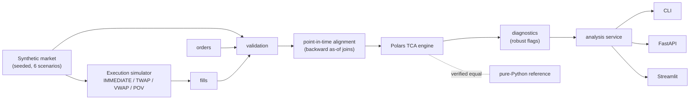

# ExecLens

**Electronic execution analytics and transaction cost analysis (TCA).**
ExecLens is a Python platform that automates TCA. It aligns orders and fills
with market data, benchmarks executions against arrival price and interval
VWAP, and measures effective spread and post-trade markouts. It also flags
unusual executions with explainable reasons and compares execution algorithms
(IMMEDIATE, TWAP, VWAP, POV) in reproducible market scenarios.

> Everything runs on **synthetic** market data from a seeded generator, and
> every execution is **simulated**. Nothing here is real market data, a
> trading strategy or a claim of profitability.

---

## The problem

A brokerage app tells you whether an investment went up. It does not tell you
whether the **execution** was good: given the bid, the ask and the market's
volume when your order arrived, did you pay a fair price?

| | Investment performance | Execution performance |
|---|---|---|
| Question | Did the asset rise after I bought it? | Given the market when I traded, how efficiently was the order filled? |
| Benchmark | Later prices | Arrival mid, interval VWAP, contemporaneous quotes |
| Unit | % return | basis points of cost |

For one order you could check this by hand. For thousands of institutional
fills, lining up every order and fill with the exact market state, without
peeking at the future, is a data engineering problem. ExecLens automates it.

## Architecture



Three layers: **domain** (data, TCA, diagnostics, simulation) → **services**
(generate, analyse) → **interfaces** (CLI, API, dashboard). Every formula lives
in one module (`tca/metrics.py`); the interfaces only display what the engine
computed. Details are in [docs/ARCHITECTURE.md](docs/ARCHITECTURE.md).

## Example

A BUY of 300 shares arrives when the mid is **100.00** and fills 100 @ 100.04
and 200 @ 100.10, while the market trades 600 shares at a VWAP of 100.09:

| Metric | Calculation | Result |
|---|---|---|
| Average fill price | (100 × 100.04 + 200 × 100.10) / 300 | 100.08 |
| Arrival cost | (100.08 − 100.00) / 100.00 × 10,000 | **+8.0 bps** (worse than arrival) |
| VWAP cost | (100.08 − 100.09) / 100.09 × 10,000 | **−1.0 bps** (better than VWAP) |
| Effective spread | quantity-weighted 2 × (price − mid) / mid | **4.0 bps** (fills at the touch) |

These are unit tests (`tests/unit/test_tca_formulas.py`), together with the
mirror-image SELL. The CLI runs the same analysis on a full dataset:

```text
$ execlens demo          # generate a synthetic day, analyse it, compare strategies
$ execlens analyze --data data/sample
| arrival cost bps: median / mean / p95 | 6.21 / 7.55 / 47.84 |
| flagged orders                        |          33 (13.8%) |
SYN_DOWN-20260105-0005 (TWAP): ['HIGH_EFFECTIVE_SPREAD', 'HIGH_PARTICIPATION']
   - Effective spread 14.2 bps is unusually high compared with SYN_DOWN orders (median 6.9 bps, robust z 5.1).
   - Order was 52.0% of market volume in its interval (threshold 25%).
SYN_WIDE-20260105-0005 (POV): ['LOW_COMPLETION']
   - Only 59.0% of the order was executed (threshold 95%).
   - Execution coincided with a wide quoted spread at arrival: 40.2 bps (median of all orders 5.0 bps).
```

Execution flags compare an order with other orders in the same symbol, so a
wide-spread instrument is not "unusual" just for being wide; market conditions
are reported as context, compared with the whole book.

## Features

* **No-look-ahead alignment.** Each order and fill is matched to the latest
  quote *at or before* its timestamp (never the nearest), with a configurable
  stale-quote tolerance. Stale data makes metrics unavailable instead of being
  forward-filled.
* **TCA metrics.** Arrival cost (implementation shortfall), interval VWAP
  cost, effective spread, quoted spread at fills, fill and mid markouts at
  10/30/60/300 s, completion, duration, and two participation measures.
* **Explainable diagnostics.** Robust median/MAD z-scores flag costs and
  adverse markouts that are unusual *for the order's symbol*; absolute
  thresholds cover participation and completion; data-quality flags cover
  stale or missing market data. Volatility, spread and liquidity are reported
  as *context*: "execution coincided with…", never "caused".
* **Execution simulator.** IMMEDIATE, TWAP, historical-profile VWAP and POV
  on identical synthetic sessions, with a deterministic square-root impact
  model. Strategies only ever see point-in-time market snapshots.
  `ORACLE_VWAP` is available as a clearly labelled, non-implementable hindsight
  benchmark. Each trial simulates only the market window its order needs, and
  a work budget caps the size of a request.
* **Deterministic synthetic markets.** Six regimes (normal, high volatility,
  low liquidity, wide spread, trend up, trend down); the same seed gives the
  same data.
* **Interfaces.** CLI (Typer), REST API with OpenAPI docs (FastAPI), a
  five-page research dashboard (Streamlit + Plotly) and ad-hoc SQL over
  Parquet (DuckDB).
* **Verified performance.** A vectorised Polars engine is benchmarked against
  a readable pure-Python reference after checking they produce the same
  numbers.

## Execution metrics

`side_sign` = +1 for BUY, −1 for SELL. **Costs: positive = worse. Markouts:
positive = favourable** (the opposite orientation).

| Metric | Formula |
|---|---|
| Mid / spread | `(bid + ask) / 2`, `(ask − bid) / mid × 10⁴` |
| Arrival cost | `side × (avg_fill − arrival_mid) / arrival_mid × 10⁴` |
| VWAP cost | `side × (avg_fill − interval_vwap) / interval_vwap × 10⁴` |
| Effective spread | `2 × side × (fill_price − mid_at_fill) / mid_at_fill × 10⁴` |
| Fill markout (h) | `side × (mid(t + h) − fill_price) / fill_price × 10⁴` |
| Mid markout (h) | `side × (mid(t + h) − mid_at_fill) / mid_at_fill × 10⁴` |
| Participation | `executed / market volume` (benchmark interval; and execution window) |
| Completion | `executed / requested` |

Definitions, worked examples, interpretations and limitations for each metric
are in [docs/METRICS.md](docs/METRICS.md).

## Strategy simulator

Every strategy trades the **same parent order in the same generated
sessions**, so differences come from the strategies, not the market. Output of
`python scripts/strategy_matrix.py` (BUY 20,000 shares over 30 minutes, 30
trials per scenario, seed 7):

| Scenario | IMMEDIATE | TWAP | VWAP | POV | Lowest mean cost (≥ 95% filled) |
|---|---|---|---|---|---|
| `normal` | 12.9 (±0.7) | 3.4 (±9.4) | 3.3 (±9.3) | 2.3 (±4.8) | POV |
| `high_volatility` | 12.2 (±0.6) | −0.2 (±23.8) | −0.4 (±24.4) | 2.1 (±10.1) | VWAP |
| `low_liquidity` | 55.4 (±4.6) | 27.2 (±13.2) | 27.1 (±13.2) | 24.4 (±13.6), 19% filled | VWAP |
| `wide_spread` | 33.6 (±2.8) | 20.2 (±9.5) | 20.3 (±9.6) | 21.0 (±6.2) | TWAP |
| `trend_up` | 13.2 (±0.7) | 11.9 (±9.6) | 11.8 (±9.7) | 6.1 (±5.8) | POV |
| `trend_down` | 13.0 (±0.7) | −9.1 (±8.3) | −9.0 (±8.2) | −2.4 (±4.7) | TWAP |

Mean arrival cost in bps, ± half-width of a 95% confidence interval. What
this run shows, scenario by scenario:

* IMMEDIATE is predictable but expensive: it pays the spread plus the full
  impact at once, and in the thin market that is about 55 bps.
* Slicing (TWAP/VWAP) lowers the mean cost in calm markets but carries timing
  risk; in high volatility the interval is about ±24 bps.
* A buyer who waits pays the drift in a rising market and benefits in a
  falling one.
* At 10% participation, POV cannot finish a large order in a thin market, so
  it is excluded from the ranking: its cost covers only the shares it bought.
* Where the intervals overlap (most rows), the "lowest" column is not a
  conclusive ranking, and no strategy is best in general.

## Performance benchmark

The loop-based reference and the Polars engine compute the same order-level
TCA (checked column by column before timing), on the `benchmark` preset:

<!-- BENCHMARK-RESULTS:START -->
```text
TCA processing benchmark (median of interleaved runs, outputs verified equal)

Python baseline    ######################################## 3.39 s
Polars             ######### 0.74 s
Polars, 1 thread   ######## 0.69 s

Measured speedup: 4.6x (16 threads), 4.9x single-threaded
Dataset: 125,714 fills / 1,547,336 market rows (1,053,935 quotes + 493,401 trades)
```

Local API p95 latency with 5,400 orders loaded: `/health` 2.8 ms, `/orders/{id}/tca` 3.8 ms.
<!-- BENCHMARK-RESULTS:END -->

Both implementations use the same algorithm (binary search and prefix
sums), so the ratio measures vectorisation and parallelism, not a cleverer
algorithm. The development laptop limits all-core power, so sixteen Polars
threads gain little over one; the ratio will differ on other machines.
Method, environment, caveats and the end-to-end (Parquet) workload are in
[docs/BENCHMARKS.md](docs/BENCHMARKS.md). The numbers above are written by
`execlens benchmark`, and a test fails if they drift from
`benchmarks/results.json`.

## Quick start

Requires Python 3.12. With [uv](https://docs.astral.sh/uv/) (uses the locked
versions in `uv.lock`):

```bash
uv sync --extra dev
uv run execlens demo                  # end-to-end: synthetic day -> TCA -> flags -> strategy comparison
uv run execlens serve                 # API on http://127.0.0.1:8000 (docs at /docs)
uv run execlens dashboard             # dashboard on http://localhost:8501
```

Or with pip: `python -m venv .venv`, activate it, run
`pip install -e ".[dev]"`, then use the same commands without `uv run`.

More commands:

```bash
execlens generate --preset sample --out data/sample   # regenerate the committed demo data
execlens analyze --data data/sample                   # TCA + diagnostics, writes data/derived/sample
execlens simulate --scenario all --trials 20          # strategy comparison for every scenario
execlens query "SELECT strategy, median(arrival_cost_bps) FROM orders_tca GROUP BY 1"
execlens benchmark                                    # >1M-row benchmark (+ API latency)
docker compose up --build                             # API :8000 and dashboard :8501 in Docker
```

## Testing

```bash
uv run ruff check . && uv run ruff format --check . && uv run mypy
uv run pytest --cov --cov-report=json && uv run python scripts/check_coverage.py
```

The suite covers:

* every metric against hand-calculated values, for BUY and SELL;
* no-look-ahead tests: nearer future quotes, rewritten future quotes, and
  strategies that must not react to future volume;
* edge cases: empty and partial fills, zero volume, stale, missing and
  duplicate quotes, invalid inputs;
* equivalence between the engine and the pure-Python reference;
* a frozen regression dataset for TCA and strategy outputs;
* API, CLI and dashboard integration: each page is run headlessly and must
  show the engine's numbers.

CI enforces ≥ 85% line coverage on `tca`, `simulation` and `diagnostics`, and
builds and smoke-tests the Docker image.

## Technology

Python 3.12 · Polars · NumPy · DuckDB · Parquet · Pydantic · FastAPI ·
Uvicorn · Streamlit · Plotly · Typer · pytest · Ruff · mypy (strict) · uv ·
Docker · GitHub Actions. There is deliberately no Kafka, Spark, Airflow or
database server: the workload is batch analytics on one machine (see
[docs/ARCHITECTURE.md](docs/ARCHITECTURE.md)).

## Limitations

This is a synthetic Level-1 market with a simplified impact model: there is no
queue position, venue routing, latency or hidden liquidity, and the simulated
fills do not move the market. It is not a regulatory best-execution product,
and simulated results do not establish trading profitability. See
[docs/LIMITATIONS.md](docs/LIMITATIONS.md) for the full list, including what a
production implementation would need.

## Roadmap

Ideas, not implemented:

* Pre-trade expected-cost models, so flags compare an order with its expected
  cost (size, volatility, time of day) rather than with its symbol's typical
  cost.
* Opportunity cost for unfilled quantity, and user-selectable benchmarks
  (open, close).
* Scenario definitions from YAML and downloadable per-order reports.
* A limit-order-book simulator with queue position.

## Why I built this

I invested in stocks and mutual funds, and retail apps made returns very
visible. I became curious about a different question: once an order is
executed, how do you tell whether the execution itself was efficient, relative
to the market at that moment? For one trade you can check by hand. At
institutional scale, analysing thousands of fills becomes a data and
automation problem, and that is what ExecLens is.

## Documentation

[METRICS](docs/METRICS.md) · [ARCHITECTURE](docs/ARCHITECTURE.md) ·
[DATA_MODEL](docs/DATA_MODEL.md) · [BENCHMARKS](docs/BENCHMARKS.md) ·
[LIMITATIONS](docs/LIMITATIONS.md) · [INTERVIEW_GUIDE](docs/INTERVIEW_GUIDE.md) ·
[RESUME_NOTES](docs/RESUME_NOTES.md) · [VERIFICATION](docs/VERIFICATION.md)

## License

MIT, see [LICENSE](LICENSE).
