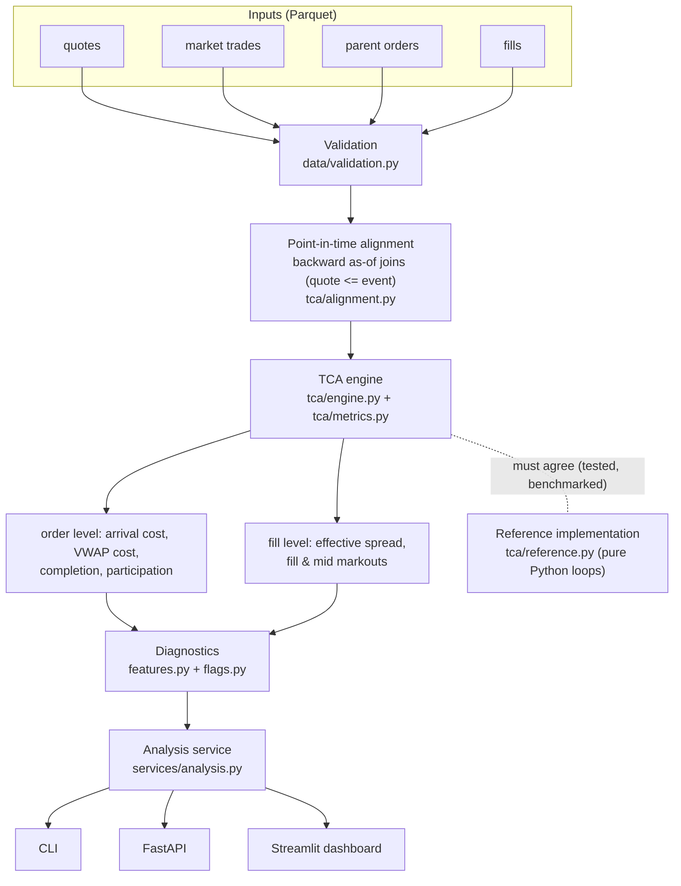
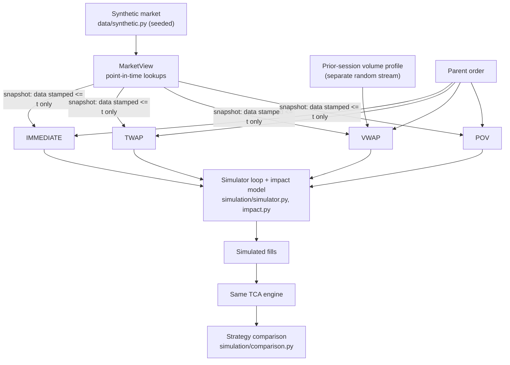

# Architecture

ExecLens is a single Python package (`src/execlens`) arranged in three layers:

1. **Domain** - data model, synthetic market, TCA engine, diagnostics,
   execution simulator. Pure functions over Polars frames. No I/O besides
   Parquet reading and writing, and no knowledge of HTTP or UI.
2. **Application services** (`execlens.services`) - compose the domain modules
   into use cases: *generate a dataset*, *analyse a dataset*. Every interface
   goes through them.
3. **Interfaces** - CLI (Typer), HTTP API (FastAPI), dashboard (Streamlit).
   Thin: they parse input, call a service, and render the result.

The most important rule in the code base: **every financial formula lives in
exactly one place** (`execlens/tca/metrics.py`). The API, CLI and dashboard only
ever display numbers the engine produced. `tests/integration/test_api.py` and
`tests/integration/test_dashboard.py` assert that what they show equals the
engine's output.

## Analysis pipeline

## Simulation pipeline

Strategies never receive the market frame. At each decision time the simulator
builds a `MarketSnapshot` from backward-looking lookups and hands only that
snapshot to the strategy. A strategy therefore cannot see future prices or
volume by construction, and `tests/unit/test_strategy_leakage.py` checks it: two
markets identical up to a cut-off must produce identical decisions up to that
cut-off. The one deliberate exception, `ORACLE_VWAP`, is built with explicit
hindsight access and is labelled `implementable = False` everywhere.

## Modules

| Module | Responsibility |
|---|---|
| `data/schemas.py` | Canonical column schemas, Pydantic record models, side sign |
| `data/validation.py` | Vectorised rule checks, `DataValidationError`, `ExecutionDataset` |
| `data/synthetic.py` | Seeded Level-1 market (six scenarios), parent orders, prior-session volume profiles |
| `data/loader.py` | Parquet persistence + provenance metadata |
| `data/repository.py` | DuckDB views over the Parquet files for ad-hoc SQL |
| `tca/metrics.py` | **All formulas**: cost bps, effective spread, markouts, mid, spread |
| `tca/alignment.py` | As-of quote context, stale/missing status, future mid for markouts, interval volume via running totals |
| `tca/engine.py` | Lazy Polars pipeline: fill level -> order level |
| `tca/reference.py` | Loop-based oracle and benchmark baseline, plus `compare_to_reference` |
| `tca/aggregation.py` | Portfolio statistics (median/mean/p5/p95, notional-weighted) |
| `diagnostics/features.py` | Pre-arrival volatility/momentum, interval move, volume rate |
| `diagnostics/flags.py` | Robust z-score rules, absolute thresholds, data-quality flags, context notes |
| `simulation/base.py` | `ParentOrder`, `MarketView`, `MarketSnapshot`, strategy interface, integer allocation |
| `simulation/{immediate,twap,vwap,pov}.py` | The four algorithms (+ `OracleVwapBenchmark`) |
| `simulation/impact.py` | Deterministic square-root temporary-impact fill model |
| `simulation/simulator.py` | Decision loop, batch simulation, strategy factory |
| `simulation/comparison.py` | Controlled strategy comparison and data-driven conclusions |
| `services/datasets.py` | Dataset presets (`sample`, `demo`, `benchmark`) and generation |
| `services/analysis.py` | TCA -> features -> flags -> summary, persistence of derived tables |
| `benchmarking.py` | Equivalence-checked, interleaved, median-reported benchmarks |
| `api/` | FastAPI app factory, schemas (with sign conventions), routes, state |
| `dashboard/` | Streamlit pages, Plotly chart builders, validated palette |
| `cli.py` | Typer commands: `generate analyze simulate query serve dashboard demo benchmark` |

## Persistence

* **Parquet** for every table: columnar, compressed and typed (UTC
  timestamps survive round trips), and readers can load only the columns they
  need. `benchmarks` shows the end-to-end difference that lazy scanning with
  column projection makes.
* **DuckDB** for ad-hoc analytical SQL (`execlens query`): views over the
  Parquet files, no import step, no server.
* Directory convention (`data/README.md`): `sample/` (committed, small),
  `raw/` (your own files), `generated/` and `derived/` (local only).

## Technology choices

| Choice | Why here |
|---|---|
| **Polars** | Columnar, multi-threaded, lazy query optimisation; first-class `join_asof` (the core point-in-time operation) and group-by aggregation. The measured speedup over an idiomatic pure-Python loop is in [BENCHMARKS.md](BENCHMARKS.md). |
| **NumPy** | Vectorised random generation for the synthetic market and binary search (`searchsorted`) in the simulator's `MarketView`. |
| **Parquet + DuckDB** | Standard analytical formats and tools that run in-process; nothing to operate. |
| **Pydantic** | Validation at the boundaries: API payloads, configs, record models. Frame-level rules are Polars expressions, because per-row Pydantic would be slow for millions of rows. |
| **FastAPI** | Typed request/response models generate OpenAPI docs automatically; `/docs` is live. |
| **Streamlit + Plotly** | A research dashboard in pure Python that reuses the same services; no separate frontend to build or keep in sync. |
| **Typer** | A CLI from type hints. |
| **uv + uv.lock** | Exact, cross-platform dependency pinning; the same lock drives local installs, CI and Docker. |

## What is deliberately not here

ExecLens processes data in batches on one machine, and a few million rows fit
comfortably in memory. So it does **not** use Kafka, Redis, Celery,
Kubernetes, Spark, Airflow, React, LLMs, vector databases or reinforcement
learning. Each would add operational surface without solving a problem the
project has. Where a production system would need them (real-time feeds,
multi-desk scale), [LIMITATIONS.md](LIMITATIONS.md) says so.

## Key design decisions

| Decision | Rationale |
|---|---|
| Backward as-of joins (`<=`), never nearest | The nearest quote can be in the future: look-ahead bias. |
| Stale quotes withheld, not forward-filled | A 10-minute-old quote is not market context; metrics become unavailable and the order is flagged. |
| Markouts are the only use of future data | By definition they measure what happened after the fill. |
| Strict fill aggregation | An order-level effective spread or markout is reported only if every fill has context; counts of unavailable fills are reported alongside. |
| Running totals for interval VWAP | O((trades + orders) log n) rather than scanning the tape per order. |
| Loop-based reference implementation | A readable specification, an independent test oracle and an honest benchmark baseline. |
| Seeded, stream-separated randomness | Same config + seed gives identical data; market, order and history streams never share draws. |
| Flags split into issues vs context | Unusual executions are flagged; market conditions are reported as context ("coincided with"), never as causes. |

## Testing layers

| Layer | Where | What |
|---|---|---|
| Formula tests | `tests/unit/test_tca_formulas.py` | Every metric against hand-calculated values, BUY and SELL |
| Temporal integrity | `tests/unit/test_temporal_integrity.py`, `test_strategy_leakage.py` | No look-ahead in context; strategies unaffected by future data |
| Edge cases | `tests/unit/test_tca_edge_cases.py`, `test_validation.py` | Empty/partial fills, zero volume, stale/missing/duplicate quotes, invalid inputs |
| Oracle equivalence | `tests/unit/test_reference_equivalence.py` | Engine = reference on generated data |
| Regression | `tests/regression/` | Frozen dataset with fixed expected TCA and strategy outputs |
| Integration | `tests/integration/` | Services, CLI, API (incl. OpenAPI), dashboard pages (AppTest), Docker-free benchmarks |

CI (`.github/workflows/ci.yml`) runs Ruff, the format check, mypy (strict),
pytest with coverage, a per-package coverage gate (>= 85% for `tca`,
`simulation` and `diagnostics`) and a smoke benchmark. A separate job builds
the Docker image and smoke-tests the CLI and API inside it.
